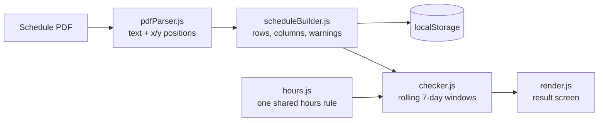

# 28-hour shift checker

[](https://github.com/tus34887-bot/28h-shift-checker/actions/workflows/test.yml)
[](LICENSE)

A mobile-first web app that reads a workplace's shift schedule PDF and tells a worker whether they stay within Japan's **28 hours in any 7 days** limit for student visas, and which shifts they can still safely take.

**Live site:** https://tus34887-bot.github.io/28h-shift-checker/


<sub>Screenshots use made-up names.</sub>

## Why I built it

Many international students in Japan may work at most 28 hours in any 7 consecutive days. The window rolls: it is not Monday to Sunday but every possible 7-day stretch. At my part-time job, the schedule comes out every two weeks as a PDF table, and coworkers on student visas had to count their own hours from it by hand. Overlapping shifts, break rules and the rolling window made mistakes easy, and going over the limit can put a visa at risk.

With this app, you upload the PDF, type your name, and get the answer on your phone in a few seconds.

## What it does

- **Reads the schedule PDF in the browser.** It supports two table layouts: with and without position letters in the header.
- **Calculates paid hours per day** from the workplace's rules: back-to-back shifts overlap by 30 minutes, unpaid breaks depend on how many shifts you work that day, and shift leaders start or finish 15 minutes outside the normal times.
- **Checks every rolling 7-day window**, including windows that cross from one schedule into the next.
- **Shows room left each day** and marks which extra shifts you could add without going over.
- **Keeps your data on your device.** Schedules are saved in the browser, with JSON backup and restore, and you can delete them at any time.

## How it works



### Reading a table out of a PDF

A PDF has no rows or columns, only pieces of text at x/y positions. The parser rebuilds the table from those positions:

- It groups text into lines by y position, finds the header line, and assigns each name to a column by its x position.
- **Names that run into each other** (two neighbouring cells extracted as one string, like `SmithJones`) are split at the column boundary. The app estimates the character width and snaps the cut to a capital letter or a space. If no safe cut exists, the cell is flagged on the Review step for the user to fix. It is never silently dropped, because that would under-count someone's hours.
- **Pages without a header** reuse the previous page's columns. In the layout **without position letters**, the nine name slots are found by clustering where names start in the data rows.
- Rows are anchored on the "Shift N" cell, so a name that wraps onto a second line can't turn into a fake row. Stray rows and printed times that don't match the rules produce warnings instead of wrong numbers.

### One rule for everyone

Every worker's hours go through a single function, `dayMinutes()` in [`js/hours.js`](js/hours.js). It treats consecutive shifts as one continuous block, subtracts the break for the day's shift count, and adds 15 minutes for opening or closing leaders. All times are whole minutes, so there are no floating-point rounding errors. Every rule value lives in [`js/config.js`](js/config.js).

### Unknown is not zero

Days outside an uploaded schedule are treated as **unknown**, not as 0 hours, and windows that include them are marked "partly unknown". Counting a gap between two schedules as zero hours would make a risky week look safe.

### Privacy and security

- **No server.** The PDF is read with [pdf.js](https://mozilla.github.io/pdf.js/) on the user's device and never uploaded. pdf.js is pinned, stored in this repo, and opened with `isEvalSupported: false`.
- **A strict Content Security Policy** blocks inline scripts and styles and any request to another site.
- **Names from the PDF are added to the page as plain text** (`textContent`), never as HTML.
- **The page carries a `noindex` tag** so search engines don't list it. Test fixtures use the real table layout with fake names.

## Tech

- Plain JavaScript (ES modules), HTML and CSS, with no framework and no build step. The app code is about 60 KB; pdf.js (1.7 MB) loads only when a PDF is added.
- [pdf.js](https://github.com/mozilla/pdf.js) for text positions.
- Node's built-in test runner: **53 tests**, run on every push by GitHub Actions.
- Hosted on GitHub Pages.

## Project structure

| Path | Purpose |
| --- | --- |
| `js/config.js` | Shift times, break rules, the 28-hour limit |
| `js/hours.js` | `dayMinutes()`, the one hours calculation |
| `js/checker.js` | Rolling windows, unknown days, room left, shift suggestions |
| `js/pdfParser.js` | Text positions from pdf.js, header and column detection |
| `js/scheduleBuilder.js` | Table rows, merged-name splitting, warnings |
| `js/nameMatch.js` | Name matching (full-width letters, Japanese spacing) |
| `js/storage.js` | Save, delete, backup and restore, with validation |
| `js/render.js`, `js/main.js` | The page |
| `tests/` | Unit tests and fake-name PDF fixtures |

## Run it locally

ES modules don't load from `file://`, so serve the folder:

```sh
npx serve .
npm test        # Node 20 or later, no packages to install
```

## Limitations

- It is built for one workplace's PDF format and shift times. Supporting another workplace means changing `config.js` and possibly the parser.
- The 28-hour limit covers all jobs combined, and this app only counts shifts from the uploaded schedule.
- The long-vacation rule (up to 8 hours a day during official school breaks) is not modelled.

It is a helper, not legal advice.

## License

[MIT](LICENSE)
